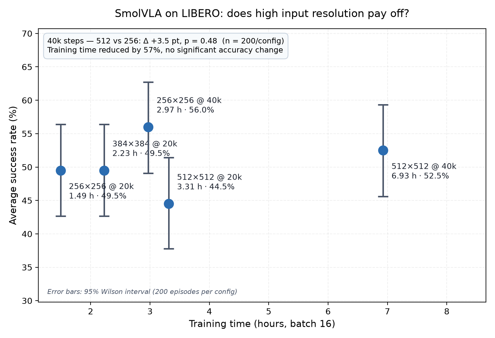

# vla-resolution-cost

在 8GB 单卡上微调 SmolVLA，量清楚"输入分辨率"这一项到底值多少钱。

LeRobot 的 SmolVLA 默认把 LIBERO 的 256×256 观测放大到 512×512 再送进 VLM。视觉编码器的 patch 是 16，所以视觉 token 从 256 个涨到 1024 个。而编码器是冻结的——我一开始觉得这 4 倍算力是白花的，但这种事得测，不能拍脑袋。

测完了，结论在下面。

## 结论

**一、训练和评测都用 256，不掉点。**

40k 步下 512 是 52.5%，256 是 56.0%，差 3.5 点，p = 0.48（n = 200/配置）。同时训练时间从 6.93 h 降到 2.97 h，显存峰值从 5223 MiB 降到 3436 MiB。

**二、但分辨率不能在推理时改。**

训 512 评 256，成功率从 44.5% 掉到 1.0%；反方向训 256 评 512，掉到 0.0%。两个方向都测了，各 200 episodes。所以想要 256，得从训练开始就用 256，不能训完再降。

**三、长程任务不吃分辨率。**

LIBERO-10 在 5 个配置里都卡在 32–34%，同期其他套件在 40k 时涨了 6–14 点。看起来它的瓶颈是多步误差累积，跟视觉信息量和训练量都没什么关系。

## 结果



横轴是训练时间，纵轴是平均成功率，误差棒是 95% Wilson 区间（每配置 200 episodes）。20k 的三个点挤在左边，40k 的两个在右边。


每配置 200 episodes（4 套件 × 10 任务 × 5 集）。表由 `make_pareto.py` 从 `summary.jsonl` 生成，没有手抄。

| 实验 | 显存(MiB) | 训练(min) | spatial | object | goal | long | 平均 |
|---|---:|---:|---:|---:|---:|---:|---:|
| base_r512_bf16 | 4948 | 199 | 40.0 | 54.0 | 50.0 | 34.0 | 44.5 |
| r384_bf16 | 3948 | 134 | 50.0 | 44.0 | 72.0 | 32.0 | 49.5 |
| r256_bf16 | 3332 | 90 | 46.0 | 56.0 | 64.0 | 32.0 | 49.5 |
| r512_40k | 5223 | 416 | 50.0 | 60.0 | 68.0 | 32.0 | 52.5 |
| r256_40k | 3436 | 178 | 56.0 | 62.0 | 74.0 | 32.0 | 56.0 |

统计（两比例 z 检验，n = 200/配置）：

- 512@20k vs 256@20k：+5.0 点，p = 0.32
- 512@40k vs 256@40k：+3.5 点，p = 0.48
- 512@20k vs 512@40k：+8.0 点，p = 0.11
- 256@20k vs 256@40k：+6.5 点，p = 0.19

n = 200 的能力只够发现 10 点以上的差异，所以上面只能写"未检测到显著差异"，不能写"两者相同"。注意连训练翻倍（+8.0 点）都没到显著，说明这个样本量本身的灵敏度就到这儿了。

评测用的是固定初始状态（`init_states=true`），所以各配置是在同一批 200 个初始条件下比较的，可以做配对检验。McNemar 的结果和 z 检验一致：512@40k vs 256@40k 是 b=40 / c=47、p = 0.52；512 从 20k 到 40k 是 b=30 / c=46、p = 0.085（这个降了但也没过线）。跑 `python scripts/stats_check.py` 能看到全表。

### 机制验证：2×2 训测分辨率矩阵

不重训，只复制 checkpoint 改 `config.json` 里的分辨率，再分别评测：

| | 评测 512 | 评测 256 |
|---|---|---|
| **模型训于 512** | 44.5% | 1.0% |
| **模型训于 256** | 0.0% | 49.5% |

对角线正常，非对角线两个方向都塌到 0–1%（各 200 episodes，p < 0.001）。

说明掉点不是"256 的信息不够"（256 训出来的模型能到 49.5%），而是训练和评测对不上。这个实验把"高分辨率没用"这个观察，变成了"必须一次定死"这条规则。

完整的一页版在 [REPORT.md](REPORT.md)。

## 快速开始

```bash
cd ~/vla-resolution-cost

# 环境自检，8 项，哪项不过会直接告诉你原因
bash scripts/setup_env.sh

# 测这张卡能跑多大 batch
bash scripts/probe_batch.sh 4 6 8

# 冒烟：200 步跑通全流程（几分钟）
python scripts/run_sweep.py --steps 200 --only base_r512_bf16 --force

# 正式训练
python scripts/run_sweep.py --only base_r512_bf16

# 评测（--n-episodes 是每任务的集数，5 → 每配置 200 集）
python scripts/eval_all.py --only base_r512_bf16 --n-episodes 5

# 统计
python scripts/stats_check.py

# 出图
python scripts/make_figures.py

# 机制验证（要先把 512 和 256 两个模型训完）
python scripts/mechanism_test.py --all --reuse-main --n-episodes 5
python scripts/mechanism_report.py
```

另外两个脚本：`make_pareto.py` 现在只生成 `results/table.md`（画图功能已经挪到 `make_figures.py` 了），`common.py` 是其他脚本共用的工具层。

## 目录

```
vla-resolution-cost/
├── configs/experiments.yaml   实验清单，唯一需要手改的文件
├── scripts/
│   ├── common.py              路径、配置合并、命令构造、显存轮询、子进程执行
│   ├── run_sweep.py           批量训练，带 .done 断点
│   ├── eval_all.py            批量评测，含分辨率一致性校验
│   ├── stats_check.py         Wilson 区间 + z 检验 + 配对 McNemar
│   ├── make_figures.py        三张图
│   ├── make_pareto.py         只出 table.md
│   ├── mechanism_test.py      2×2 矩阵（纯推理）
│   ├── mechanism_report.py    矩阵判定
│   ├── probe_batch.sh         显存探针
│   └── setup_env.sh           环境自检
├── results/
│   ├── summary.jsonl          训练 + 评测记录，所有数字的来源
│   ├── mechanism.jsonl        2×2 矩阵
│   ├── table.md               自动生成
│   ├── runs/                  各实验 checkpoint（体积大，已 gitignore）
│   ├── logs/                  训练与评测日志
│   └── figures/
├── REPORT.md                  一页技术报告
├── SETUP.md                   环境搭建与踩过的坑
└── VERSION.txt                框架/驱动/依赖版本
```

主实验这条线是 `run_sweep` → `eval_all` → `stats_check` → `make_figures`；机制验证是另一条独立的 `mechanism_test` → `mechanism_report`，只跑推理。

## 编辑实验清单

`configs/experiments.yaml` 里 `common` 是所有实验共用的参数，`experiments` 里每项只写和 common 不一样的部分：

```yaml
common:
  policy.pretrained_path: lerobot/smolvla_base
  dataset.repo_id: lerobot/libero
  batch_size: 16
  steps: 20000
  accelerator.mixed_precision: bf16

experiments:
  - name: r256_bf16
    desc: 输入降到 256
    overrides:
      policy.resize_imgs_with_padding: [256, 256]
```

`run_sweep.py` 会把两段合并成一条命令。建议先用 `--print-cmd` 看一眼：

```bash
python scripts/run_sweep.py --print-cmd --only r256_bf16
```

参数名对不上就改 yaml 里的 key，不用改代码。LeRobot 0.6.x 用的是 `policy.pretrained_path`，早期文档里的 `policy.path` 已经没有了。如果哪天又改名，可以这样列全：

```bash
lerobot-train --policy.type=smolvla --help | grep -oE '\-\-policy\.[a-z_]+'
```

## 常见问题

**报 unrecognized argument。** 参数改名了。先 `lerobot-train --help | grep -i "resize\|precision\|accum"` 核对，然后改 yaml 里的 key。

**报 feature mismatch 或 shape 错。** 从 base checkpoint 微调时可能要显式清空特征定义，在 `common` 里加：

```yaml
policy.output_features: null
policy.input_features: null
```

**HuggingFace 连不上。** 国内网络下 `huggingface.co` 一般超时，用镜像：

```bash
export HF_ENDPOINT=https://hf-mirror.com
export HF_HUB_DISABLE_XET=1     # 不加这句，Xet 存储会绕开镜像，报 401
```

**MuJoCo 渲染报错。** 换后端：

```bash
export MUJOCO_GL=egl      # 首选
export MUJOCO_GL=osmesa   # 软件渲染，慢但稳
```

**脚本报 bad interpreter。** Windows 上建的文件带 CRLF，`sed -i 's/\r$//' scripts/*.sh` 一下。

## 结果文件

`results/summary.jsonl` 每行一条记录，训练和评测用 `stage` 区分，靠 `name` 合并。评测记录长这样：

```json
{"ts": "2026-11-05T09:32:10", "stage": "eval", "name": "r512_40k", "source": "lerobot-eval",
 "suites": {"spatial": 0.5, "object": 0.6, "goal": 0.68, "libero_10": 0.32},
 "avg": 0.525, "n_episodes": 200, "seed": 1000, "lerobot_commit": null}
```

`lerobot_commit` 是 null，因为这套 LeRobot 是 pip 装的（非 git 检出），查不到 commit。版本信息见 `VERSION.txt`。

## 已知局限

- 每个配置只训了 **1 个 seed**（seed=1000），训练随机性带来的方差没测。
- 每配置 200 episodes，CI 大约 ±7 点，**只能发现 10 点以上的差异**。
- 绝对成功率 52–56%，20k 步只等于 1.17 个 epoch，远没训到饱和。结论限定在低资源区间。
- 纯仿真，没验证真机。
- 机制结论只适用于**冻结视觉编码器**的设定。解冻之后模型可能能适应新分辨率，没测。
- 没做的轴：fp32、LoRA、梯度累积、第二 seed、24GB 对照、解冻视觉编码器。
